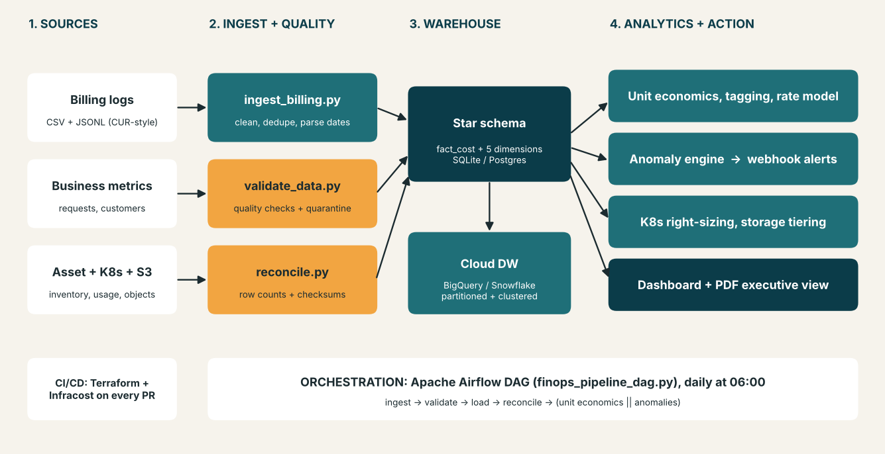
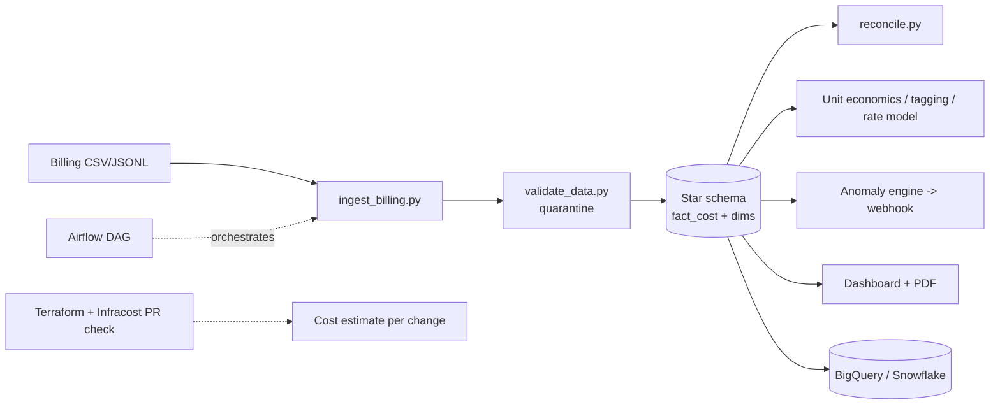

# Cloud Financial Intelligence Platform

An end-to-end Data Engineering + Cloud FinOps project built during the PACEX 21-day internship: ingest cloud billing data, model it in a star schema, validate and reconcile it, analyse cost and unit economics, detect anomalies, model savings, and present everything in an executive dashboard.

> **Data note:** all billing, inventory, Kubernetes and storage data is **synthetic** (generated by `src/generate_data.py`, AWS CUR-style, with deliberate duplicates, nulls and bad dates). The methods are real; the dollar figures are not. Discount rates and prices in the models are illustrative assumptions, stated in each file.





## Headline results (synthetic data, 90 days)
| Metric | Result |
|---|---|
| Rows ingested -> loaded | 11,545 -> 11,034 clean (114 duplicates removed, 397 quarantined); reconciliation: zero data loss |
| Index benchmark (662k rows) | 3.6x to 12.9x faster queries (timings vary by machine; see `reports/day05_index_report.md`) |
| Identified saving (annualised) | about 16.8% of spend (waste removal + commitments/Spot, netted for overlap) |
| Cost per 1k API requests | $0.89 -> $1.09 (+23%) over the period |
| Anomaly engine | caught 3 of 3 injected spikes (z-score 7.0 to 9.6), plus 3 low-severity flags |
| Tests | 6 unit tests pass |

## Quick start
```bash
pip install -r requirements.txt
python src/generate_data.py      # synthetic raw data
python src/run_pipeline.py       # ingest -> validate -> load -> reconcile -> unit economics -> anomalies
python src/reconcile.py          # expect: ZERO DATA LOSS - ALL CHECKS PASSED
python -m unittest tests.test_etl tests.test_anomaly
pip install streamlit && streamlit run dashboard/app.py     # dashboard
```
Full script order is in [`docs/RUN_ORDER.md`](docs/RUN_ORDER.md). Always run from the project root.

## Repository layout
| Folder | Contents |
|---|---|
| `src/` | Python modules: ETL, loader, validation, reconciliation, analytics, anomaly engine, models, dashboard export |
| `sql/` | Star-schema DDL, 8 analytical queries, indexes, BigQuery/Snowflake DDL, depreciation view |
| `dags/` | Airflow DAG (`finops_pipeline_dag.py`) |
| `dashboard/` | Streamlit app |
| `terraform/` + `.github/workflows/` | Sample IaC and the Infracost PR workflow |
| `reports/` | Generated reports (profiling, data quality, reconciliation, audit, K8s, etc.) |
| `outputs/` | Excel models, decks, PDF, query CSVs |
| `docs/` | Tagging policy, lifecycle policy JSON, architecture, how-tos |
| `tests/` | Unit tests |

## Day-by-day deliverables
| Day | Topic | Key files |
|---|---|---|
| 1 | Star-schema model | `sql/01_schema.sql`, `src/load_warehouse.py` |
| 2 | Advanced SQL (8 queries) | `sql/02_analytics.sql`, `outputs/day02/` |
| 3 | Python ETL | `src/ingest_billing.py` |
| 4 | Cost profiling | `src/profile_costs.py`, `reports/day04_*` |
| 5 | Indexing | `sql/03_indexes.sql`, `reports/day05_index_report.md` |
| 6 | Data quality | `src/validate_data.py`, `reports/day06_*` |
| 7 | Reconciliation | `src/reconcile.py`, `reports/day07_*` |
| 8 | Unit economics | `src/unit_economics.py`, `reports/day08_executive_memo.md` |
| 9 | Tagging governance | `docs/tagging_policy.md`, `src/audit_untagged.py` |
| 10 | Cloud warehouse | `sql/10_bigquery_ddl.sql`, `sql/10_snowflake_ddl.sql`, `docs/day10_benchmark_log.md` |
| 11 | Rate optimisation | `outputs/rate_optimization_model.xlsx` |
| 12 | Anomaly detection | `src/anomaly_engine.py` |
| 13 | Kubernetes right-sizing | `src/k8s_rightsizing.py` |
| 14 | Mid-term audit | `outputs/Day14_Mid-Term_Audit.pptx` |
| 15 | Orchestration | `dags/finops_pipeline_dag.py`, `docker-compose.airflow.yml`, `src/run_pipeline.py` |
| 16 | Amortisation | `sql/16_depreciation.sql`, `outputs/asset_amortization_model.xlsx` |
| 17 | IaC cost estimation | `terraform/main.tf`, `.github/workflows/infracost.yml` |
| 18 | Dashboard | `dashboard/app.py`, `outputs/Day18_Executive_View.pdf` |
| 19 | Storage lifecycle | `docs/s3_lifecycle_policy.json`, `outputs/storage_tiering_model.xlsx` |
| 20 | Capstone integration | this README, `docs/architecture.png` |
| 21 | Final presentation | `outputs/Day21_Final_Presentation.pptx`, `docs/demo_script.md` |

## Design decisions
- **Star schema, surrogate keys, FK constraints:** fast aggregation, enforced integrity. Billing line item is the fact grain.
- **Quarantine instead of drop:** bad rows are kept in `billing_quarantine.csv` and the `quarantine_billing` table with a reason, so nothing disappears silently.
- **Reconciliation as a gate:** `reconcile.py` exits non-zero on any count or checksum mismatch, so an orchestrator can stop the pipeline.
- **Baseline excludes the current day** in anomaly detection, so a spike cannot hide itself in its own average.
- **Savings are netted:** waste is removed first and rate savings are scaled to the remaining spend to avoid double counting.

## Verification status (be explicit about what was run)
| Component | Status |
|---|---|
| ETL, warehouse, SQL, analytics, anomaly, models, PDF | Run and verified; outputs cross-checked (Excel vs SQL vs Python) |
| Airflow DAG | Syntax-checked; the same task order is exercised by `src/run_pipeline.py`. Run `docker-compose.airflow.yml` to produce the DAG graph |
| Streamlit app | Syntax-checked; shares `src/metrics.py` with the PDF export, which was run |
| Terraform / Infracost | Written, not executed here. See `docs/day17_infracost_howto.md` |
| BigQuery / Snowflake | DDL written; run it in your own account and fill `docs/day10_benchmark_log.md` |

## Limitations and next steps
- Linear forecast and z-score baseline have no seasonality (day-of-week) adjustment.
- Commitment coverage is modelled; real RI/Savings Plan data would replace it.
- Next: real CUR ingestion from S3, dbt models, per-weekday anomaly baselines, budget alerts per team.
